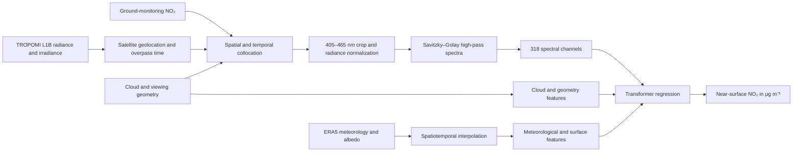
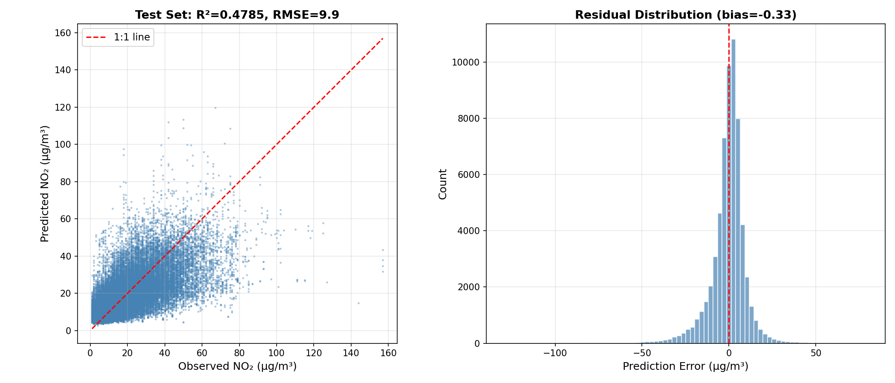
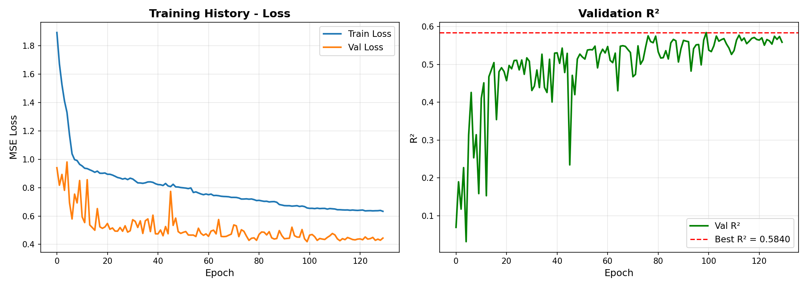

# Direct Near-Surface NO₂ Estimation from TROPOMI L1B Spectra with Transformers

## Overview

This research project investigates whether near-surface nitrogen dioxide (NO₂) concentrations over China can be estimated directly from Sentinel-5P/TROPOMI Level-1B radiance spectra. The current workflow combines spectral information in the 405–465 nm window with cloud properties, viewing geometry, ERA5 meteorology, and ground-monitoring observations in a Transformer regression framework.

The project is intended as a GeoAI and environmental remote-sensing study rather than an operational air-quality product. All results below are preliminary.

## Research question

How much information about near-surface NO₂ can be recovered directly from TROPOMI Level-1B radiance spectra when spectral structure is modeled jointly with atmospheric, surface, and observation-geometry covariates?

## Study area and target

- **Study area:** China (the current collocation domain is approximately 18–54° N and 73–135° E).
- **Prediction target:** ground-monitored near-surface NO₂ concentration in μg m⁻³.
- **Satellite input:** TROPOMI Band 4 radiance spectra cropped to 405–465 nm (318 spectral channels in the current implementation).

## Data sources

- **Sentinel-5P/TROPOMI Level-1B radiance spectra:** Band 4 radiance and irradiance measurements used to construct normalized spectral inputs.
- **Cloud and viewing-geometry variables:** cloud fraction, cloud-top pressure, cloud radiance fraction, solar zenith angle, viewing zenith angle, and azimuth angle.
- **ERA5 meteorological variables:** boundary-layer height, 2 m temperature, surface pressure, and forecast albedo in the current feature set.
- **Ground-monitoring observations:** station-based NO₂ measurements used as the near-surface regression target after spatiotemporal collocation.

The underlying satellite, meteorological, and monitoring datasets are not redistributed here. Their use and redistribution remain subject to the terms of their respective providers.

## Method overview

The current model treats each spectral channel and auxiliary variable as a token. A learnable embedding maps each scalar feature to a 128-dimensional representation, followed by a four-layer, eight-head Transformer encoder. Global average pooling and a multilayer regression head produce one near-surface NO₂ estimate per collocation. The preliminary configuration contains 860,417 trainable parameters.

The spectral branch uses irradiance-normalized log reflectance followed by Savitzky–Golay high-pass filtering. The model input contains 318 filtered spectral channels and 10 auxiliary features. Experiments completed to date include spectral/auxiliary-feature ablations, self-supervised masked-spectral pretraining, and temporally held-out evaluation.

## Data collocation and preprocessing pipeline

In the implemented pipeline, station observations are matched to satellite overpasses within a 30-minute window and to the nearest valid satellite pixel. Radiance is normalized by irradiance and solar geometry, cropped to the 405–465 nm spectral window, and high-pass filtered. ERA5 variables are interpolated to the collocated pixel location and overpass hour. Quality control removes invalid spectra and meteorological records and applies documented geometry and target-range filters.

## My contributions

- Designed and implemented the satellite–station spatiotemporal collocation workflow.
- Developed the TROPOMI L1B spectral normalization and preprocessing pipeline.
- Integrated cloud, viewing-geometry, ERA5 meteorological, and surface features.
- Built and trained the Transformer regression model for near-surface NO₂ estimation.
- Conducted spectral and auxiliary-feature ablations, masked-spectral self-supervised pretraining, and temporal evaluation experiments.
- Added a fully blocked temporal train/validation/test split for the next evaluation stage.

## Preliminary results

The current preliminary temporally held-out test set contains **61,954 satellite–station collocations**.

| Metric | Preliminary value |
|---|---:|
| R² | 0.48 |
| RMSE | 9.90 μg m⁻³ |
| MAE | 6.66 μg m⁻³ |

*Preliminary test diagnostics. The plot was generated from the same 61,954-collocation test set summarized above. Performance degrades at the upper end of the observed concentration range, which remains an important target for model improvement.*

*Training diagnostics for the preliminary run. The validation subset used for model selection in this run was randomly sampled from the training-period pool; it was not a blocked temporal validation set.*

## Evaluation protocol and limitations

The preliminary test partition is temporally held out by assigning the later dates within each sampled month to the test set. The current dataset construction covers selected months in April, July, and October 2023 and January 2024. However, the preliminary training run used a random validation split within the earlier-date training pool for model selection. Consequently, these results should **not** be interpreted as evidence that the model has already demonstrated robust generalization to unseen periods.

A fully blocked temporal split has now been added to the project, separating training, validation, and test dates. Results from that protocol are not yet available and are therefore not reported here.

Additional limitations include incomplete seasonal and interannual coverage, spatial dependence among collocations, potential representativeness differences between satellite pixels and point monitors, uncertainty in cloud screening and meteorological interpolation, and weaker performance for high-concentration events. The current model is a research prototype and is not intended for regulatory or operational use.

## Current status

This project is currently under active development. Source code and research data are not yet publicly available.

The end-to-end workflow for collocation, preprocessing, feature fusion, model training, ablation studies, masked-spectral pretraining, and preliminary temporal testing has been implemented. Current work focuses on more rigorous validation, robustness analysis, and physically informed extensions.

## Ongoing and future work

- I am investigating performance under the fully blocked temporal split and across seasons, regions, stations, and concentration regimes.
- I am exploring CTM-derived vertical profiles and surface-to-column relationships as additional physical context.
- I plan to incorporate physics-guided consistency constraints linking spectral information, atmospheric structure, and near-surface concentrations.
- I am investigating uncertainty quantification, high-pollution-event performance, and comparisons with simpler statistical and machine-learning baselines.

## Data and code availability

This repository is a research showcase and contains only a project description and sanitized preliminary figures. It does not contain raw satellite data, station observations, ERA5 files, collocation tables, model checkpoints, training artifacts, or source code.

This project is currently under active development. Source code and research data are not yet publicly available.

## Contact

For academic inquiries or potential collaboration, please contact the project author through the GitHub profile associated with this repository.

